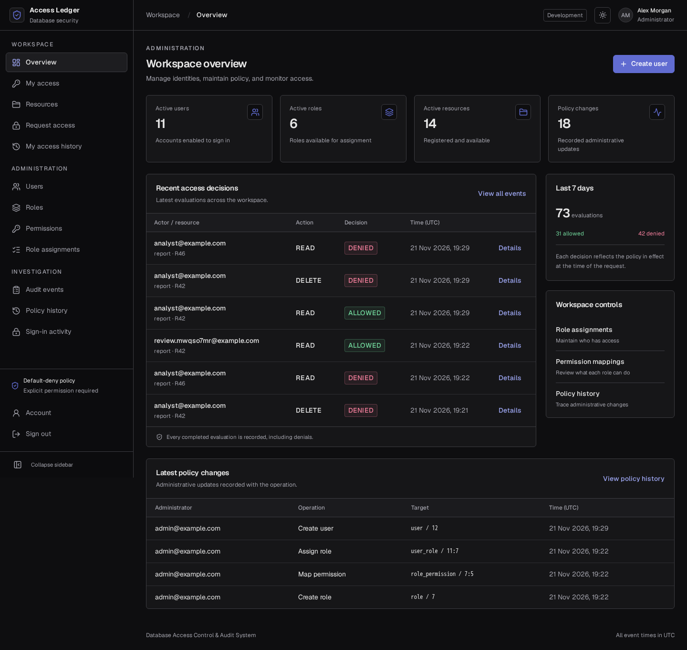
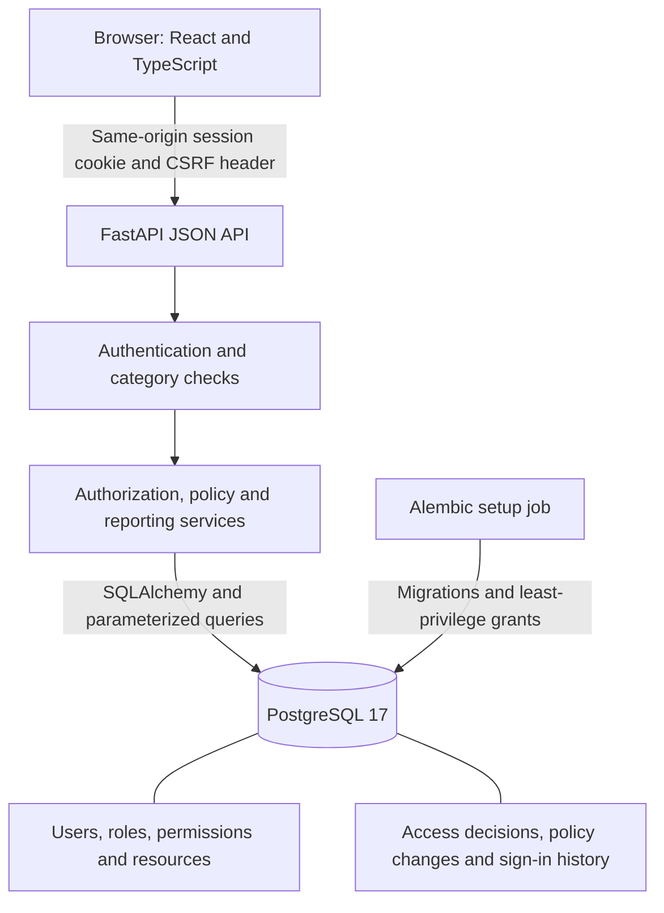

# 🔐 Database Access Control and Audit System

> **Access Ledger** — a Database Systems project for managing role-based access and recording the decisions behind every resource request.

[](docker-compose.yml)
[](requirements.txt)
[](frontend/package.json)
[](frontend/package.json)
[](docs/TEST_RESULTS.md)

📄 [Project report](docs/submission/Project_Report.pdf) · 🗂️ [Complete ER diagram](docs/submission/ER_Diagram.pdf) · 💻 [GitHub repository](https://github.com/SyedMuzammil2028/database-access-control-audit-system)



[Light theme](docs/screenshots/admin-light.png) · [Auditor workspace](docs/screenshots/auditor-dark.png) · [Mobile preview](docs/screenshots/mobile-dark.png)

---

## 📋 Table of Contents

1. [Overview](#-overview)
2. [Problem Statement](#-problem-statement)
3. [Solution](#-solution)
4. [Key Features](#-key-features)
5. [Technology Stack](#-technology-stack)
6. [Project Structure](#-project-structure)
7. [Installation & Setup](#-installation--setup)
8. [Running the Project](#-running-the-project)
9. [How to Use](#-how-to-use)
10. [Testing](#-testing)
11. [Admin Functions](#-admin-functions)
12. [Architecture](#-architecture)
13. [Database Design & ER Diagram](#-database-design--er-diagram)
14. [Security Features](#-security-features)
15. [Troubleshooting](#-troubleshooting)
16. [Project Report & Submission](#-project-report--submission)
17. [Future Enhancements](#-future-enhancements)
18. [Team](#-team)
19. [License & Acknowledgments](#-license--acknowledgments)
20. [Project Status](#-project-status)

---

## 🌟 Overview

Access Ledger brings user accounts, roles, permissions, resources and audit history into one application. Administrators manage access policy, ordinary users check their access, and auditors investigate decisions without changing policy.

The React interface reads its records and dashboard counts from PostgreSQL through a FastAPI API. Both dark and light themes support desktop and mobile screens.

This project evaluates **READ, CREATE, UPDATE and DELETE permissions** for registered documents and reports. A request records whether an operation would be allowed; it does not open or modify the underlying document, execute user-supplied SQL, or intercept unrelated database traffic.

---

## 🎯 Problem Statement

A list of user accounts alone cannot explain who should have access to a resource or why a request was approved. When permissions change, an organisation also needs a record of the earlier policy and the administrator responsible for the change.

The project addresses four practical questions:

- Which permissions does a user receive through their active roles?
- Should a particular operation on a resource be allowed now?
- Can an earlier decision still be understood after a role is renamed or revoked?
- Can an auditor investigate access without being able to alter the policy?

---

## 💡 Solution

### How it works

1. An administrator creates users, roles and registered resources.
2. Permissions are mapped to roles, and roles are assigned to users.
3. A signed-in user selects a resource and operation.
4. The backend checks account, resource, role and permission status. Missing permission means **DENIED**.
5. PostgreSQL stores the decision, reason, actor, resource and matching role before the result is returned.
6. Administrators and auditors can search the resulting history and export a filtered CSV.

Historical events keep snapshots of the identifiers used at the time. Later policy changes do not rewrite earlier decisions.

---

## ✨ Key Features

### For ordinary users

- View assigned roles and effective permissions.
- Browse registered resources and evaluate access requests.
- See the reason for an allowed or denied decision.
- Review personal access history.

### For administrators

- Create users and change account status.
- Create and edit roles, map permissions, and assign or revoke roles.
- Register resources and change their status.
- Investigate access, policy and sign-in history.
- Retain at least one active administrator through lockout protection.

### For auditors

- Read audit events, policy changes and sign-in activity.
- Filter by actor, action, decision, resource and UTC date range.
- Open event details and export matching decisions as CSV.
- Investigate without policy mutation privileges.

### Across the application

- Database-backed dashboards, searchable tables and pagination.
- Responsive navigation, collapsible sidebar, dark and light themes.
- Server-side authorization independent of the visible navigation.

---

## 🛠️ Technology Stack

| Layer | Technologies |
| --- | --- |
| Database | PostgreSQL 17, SQL constraints, indexes and reporting views |
| Backend | Python 3.12, FastAPI, SQLAlchemy 2, Psycopg 3, Pydantic |
| Migrations | Alembic |
| Authentication | Argon2id password hashing, server-side sessions, CSRF protection |
| Frontend | React 19, TypeScript, Vite, Tailwind CSS |
| Interface | Radix Dialog, Lucide icons, locally bundled Geist fonts |
| Tests | pytest, Vitest, React Testing Library, Playwright/Chromium |
| Local deployment | Docker and Docker Compose v2 |

Python dependencies are pinned in [requirements.txt](requirements.txt) and [requirements.lock](requirements.lock). Frontend versions are recorded in [package.json](frontend/package.json) and [package-lock.json](frontend/package-lock.json).

---

## 📁 Project Structure

```text
database-access-control-audit-system/
├── backend/app/
│   ├── models/                 # Relational entities
│   ├── routes/                 # JSON API endpoints
│   ├── schemas/                # Request and response contracts
│   ├── security/               # Passwords and sessions
│   ├── services/               # Authorization, policy and reporting
│   └── main.py                 # API and production frontend serving
├── frontend/
│   ├── src/components/         # Shared interface components
│   ├── src/pages/              # Role-specific workspace screens
│   ├── src/lib/                # Typed API client and authentication
│   ├── src/test/               # Component/API integration tests
│   └── package.json
├── alembic/                    # Database migrations
├── sql/                        # Schema, seed, views and SQL demonstrations
├── scripts/                    # Configuration, setup, seed and archive tools
├── tests/                      # PostgreSQL/backend integration tests
├── docs/
│   ├── screenshots/            # Application screenshots
│   ├── submission/             # Final report and complete ER diagram PDFs
│   ├── third-party/            # Dependency license notices
│   ├── DATABASE_DESIGN.md      # Data dictionary and normalization
│   ├── TEST_RESULTS.md         # Recorded verification results
│   └── ...                    # Installation, security and demonstration guides
├── .env.example
├── Dockerfile
├── docker-compose.yml
├── requirements.txt
├── requirements.lock
└── README.md
```

---

## 🚀 Installation & Setup

### Prerequisites

- Git.
- Docker Engine or Docker Desktop with **Compose v2**.
- Python 3 to generate local configuration.
- Free local ports **8000** and **5434**.
- Internet access for the first image and dependency build.

The Docker installation does not require Node.js or Python packages on the host.

### Step 1: Clone the repository

```sh
git clone https://github.com/SyedMuzammil2028/database-access-control-audit-system.git
cd database-access-control-audit-system
```

### Step 2: Generate local configuration

```sh
python3 scripts/configure.py
```

On Windows, use `python` if `python3` is unavailable. This creates a local `.env` with generated application and database secrets. The file is excluded from Git and submission archives.

### Step 3: Build and start

```sh
docker compose up --build -d
```

Docker builds the frontend, starts PostgreSQL, applies migrations and database grants, and seeds an empty database. Existing datasets are preserved.

---

## 🏃 Running the Project

Open **http://localhost:8000** after startup completes.

```sh
# Check service status and setup output
docker compose ps
docker compose logs setup web

# Check the application and database connection
curl http://localhost:8000/health

# Stop services while preserving database data
docker compose down
```

Keep the generated `.env` with the database volume. Regenerating configuration does not change passwords inside an existing database.

### Optional: host development

Use Python **3.12+** and Node.js **22.22.2+**. From the project root, start the backend in one terminal:

```sh
python3 scripts/configure.py
python3 -m venv .venv
. .venv/bin/activate
pip install -r requirements.txt -c requirements.lock
docker compose up -d db
docker compose run --build --rm setup
uvicorn app.main:app --app-dir backend --host 127.0.0.1 --port 8000
```

In a second terminal:

```sh
cd frontend
npm ci
npm run dev
```

Open the Vite URL, normally **http://localhost:5173**. Vite proxies `/api` to FastAPI. On PowerShell, activate the environment with `.venv\Scripts\Activate.ps1`.

---

## 📖 How to Use

### Development demo accounts

All seeded accounts below use **`AccessDemo!2026#`**. These fictional accounts are for local demonstrations; remove demo access before any external deployment.

| Category | Email addresses |
| --- | --- |
| Administrator | `admin@example.com`, `maya.admin@example.com`, `omar.admin@example.com` |
| Auditor | `auditor@example.com`, `leila.auditor@example.com`, `noah.auditor@example.com` |
| Ordinary user | `analyst@example.com`, `editor@example.com`, `viewer@example.com` |
| Inactive account | `inactive@example.com` — cannot sign in |

### Evaluate access as a user

1. Sign in as `analyst@example.com` and open **My access**.
2. Open **Resources**, find report **R42**, and select **Request access**.
3. Submit **READ**. The seeded roles allow this operation.
4. Submit a fresh **DELETE** request for R42. The result is denied.
5. Open **My access history** and inspect both decisions and their reasons.

The analyst has multiple roles. The editor can read, create and update documents; the viewer can read documents. Resource ownership alone does not grant access.

### Demonstrate a grant and revocation

1. As an administrator, create a fictional user and a role.
2. Map **READ / report** to that role and assign it to the user.
3. Sign in as the new user and request **READ** on **R42**.
4. Return as administrator and revoke the role assignment.
5. Submit a new request as the user. It is denied, while the earlier allowed event remains in history.

### Investigate as an auditor

1. Sign in as `auditor@example.com`.
2. Open **Audit events** and apply actor, resource, action or decision filters.
3. Inspect an event, then review the related **Policy history**.
4. Select both UTC dates and export the filtered CSV.

CSV exports allow up to **93 inclusive days** and **5,000 events**. See the [demonstration guide](docs/DEMO_GUIDE.md) for a complete presentation walkthrough.

---

## 🧪 Testing

### Backend and PostgreSQL

From the project root, after generating `.env`:

```sh
docker compose --profile test run --build --rm test
```

The test profile uses a separate, disposable PostgreSQL server. The fixtures reject database names without the `_test` suffix. Run these tests serially against that server.

### React components and production build

```sh
cd frontend
npm ci
npm test
npm run build
```

### Browser workflows

With the synthetic local application running at port 8000, run from `frontend/`:

```sh
npx playwright install --with-deps --only-shell chromium
npm run test:e2e
```

Browser tests create fictional accounts and policy changes. Target a development instance.

For the Linux Docker alternative, run from the project root:

```sh
docker build -f frontend/Dockerfile.e2e -t dac-playwright frontend
docker run --rm --network host --memory=640m --memory-swap=640m -e NODE_OPTIONS=--max-old-space-size=128 -v "$PWD/frontend/test-results:/work/test-results" dac-playwright
```

On Docker Desktop, omit `--network host` and add `-e PLAYWRIGHT_BASE_URL=http://host.docker.internal:8000`.

### Recorded results

The completed verification recorded on **22 November 2026** includes:

| Suite | Result |
| --- | --- |
| Backend/PostgreSQL integration | 113 passed |
| React component/API integration | 12 passed |
| Playwright browser workflows | 5 passed |
| TypeScript/Vite production build | Passed |

These are recorded runs, not a live CI badge. Coverage includes permission decisions, rollback on audit failure, concurrent administrator changes, filtered CSV, role restrictions, responsive screens and complete grant/revocation workflows. See [test results and evidence](docs/TEST_RESULTS.md).

---

## 👨‍💼 Admin Functions

| Capability | Administrator | Auditor | Ordinary user |
| --- | --- | --- | --- |
| Manage users, roles, assignments and mappings | ✅ | — | — |
| Register resources and change their status | ✅ | — | — |
| Investigate all access, policy and sign-in events | ✅ | ✅ | — |
| Export filtered audit CSV | ✅ | ✅ | — |
| Evaluate resource access | ✅ | — | ✅ |
| View own effective access and decision history | ✅ | — | ✅ |

Administrative authority permits policy management. Resource operations still require an explicit permission mapping, including for administrators. Auditor-only accounts cannot evaluate resource operations or change policy.

Changes to users, roles, assignments, mappings and resources are recorded in policy history. The backend rejects changes that would remove the last active administrator.

---

## 🏗️ Architecture



### Access decision flow

```text
Signed-in user → Validated request → Active account and resource checks
             → Role/permission match → Durable audit insert and commit
             → ALLOWED or DENIED response
```

If the decision cannot be recorded safely, the API returns an error rather than an allowed result. Request UUIDs let a retry return the original decision without inserting a duplicate event.

The production FastAPI service serves both the frontend and API. Session tokens remain in HttpOnly cookies; theme and sidebar preferences are the only UI state persisted in browser local storage.

The [OpenAPI contract](docs/openapi.json) also generates the frontend API types. After changing a contract, regenerate it from the root on Unix:

```sh
PYTHONPATH=backend .venv/bin/python -m scripts.export_openapi
cd frontend
npm run api:types
npm run build
```

On PowerShell, set `$env:PYTHONPATH="backend"` and run `.venv\Scripts\python.exe -m scripts.export_openapi` before the frontend commands.

---

## 🗂️ Database Design & ER Diagram

The implemented schema contains **10 application tables, 62 columns and 12 foreign keys**. Eight tables represent policy and history; two support authentication and sign-in investigation.

| Table | Purpose |
| --- | --- |
| `app_user` | Accounts, password hashes and account status |
| `role` | Named roles and workspace categories |
| `permission` | Action and resource-type combinations |
| `user_role` | User-to-role assignments and revocation status |
| `role_permission` | Role-to-permission mappings |
| `resource` | Registered documents/reports and ownership |
| `audit_event` | Access decisions and historical snapshots |
| `policy_change` | Administrative changes and their details |
| `login_session` | Hashed session tokens and expiry |
| `security_event` | Sign-in successes, failures and logout events |

### Relationships and integrity

- Users and roles have a many-to-many relationship through `user_role`.
- Roles and permissions have a many-to-many relationship through `role_permission`.
- Resource owners and event actors reference user accounts.
- Primary, composite, foreign, unique and check constraints enforce integrity in PostgreSQL.
- Live policy is normalized; audit snapshots deliberately preserve historical identifiers.
- `effective_user_permission` and `daily_access_summary` provide reporting views.

📐 [Complete printable ER diagram](docs/submission/ER_Diagram.pdf) · [Mermaid ER diagram](docs/ERD.md) · [Data dictionary and normalization](docs/DATABASE_DESIGN.md)

### SQL demonstrations

Run against the local demonstration database from the project root:

```sh
docker compose exec -T db psql -U dac_owner -d dac -v ON_ERROR_STOP=1 < sql/queries.sql
docker compose exec -T db psql -U dac_owner -d dac -v ON_ERROR_STOP=1 < sql/constraints.sql
docker compose exec -T db psql -U dac_owner -d dac -v ON_ERROR_STOP=1 < sql/transactions.sql
```

These demonstrate joins, aggregation, `GROUP BY`, `HAVING`, subqueries, constraints and transaction rollback. Alembic is the canonical schema; the standalone DDL is generated from it. For PowerShell, pipe `Get-Content -Raw sql/queries.sql` into the corresponding `docker compose exec -T ...` command. See the [SQL demonstration guide](docs/SQL_DEMONSTRATION.md).

---

## 🔒 Security Features

| Area | Implemented behavior |
| --- | --- |
| Password storage | Salted Argon2id hashes |
| Sessions | Opaque HttpOnly/SameSite cookies; hashed server-side tokens; expiry and logout |
| Request protection | CSRF validation for login and authenticated writes |
| Authorization | Backend role checks, active-state checks and default-deny resource decisions |
| Policy changes | Transactional writes with policy history and last-administrator protection |
| Audit history | No application edit/delete routes; runtime DB role cannot update/delete history |
| Retry handling | Actor-scoped request UUIDs with payload-conflict detection |
| Reporting | Role restrictions, bounded exports and spreadsheet formula escaping |
| Runtime | Restricted database account, non-root container and security headers |

The database owner and superusers remain able to alter stored data. This prototype does not provide an externally sealed audit archive, MFA, SSO or independent security certification. External deployment requires HTTPS with secure cookies and removal of demo access. Full behavior and operational limits are documented in [SECURITY.md](docs/SECURITY.md).

---

## 🐛 Troubleshooting

| Issue | What to check |
| --- | --- |
| Port already in use | Free ports 8000/5434 or update Compose bindings. A changed host DB port also requires updating the host `.env` connection URL. |
| Application does not start | Run `docker compose ps` and `docker compose logs setup web db`. Check that migration/setup completed. |
| Database rejects credentials after replacing `.env` | Restore the configuration matching the existing volume. Generating a new file does not rotate database passwords. |
| Login fails | Check the exact demo email/password and account status. Ten failed attempts cause a fifteen-minute throttle. |
| Frontend build missing during host development | Start Vite or run `npm run build` in `frontend/`. |
| CSV export is rejected | Supply both UTC dates, use at most 93 inclusive days and narrow the result to 5,000 events or fewer. |
| Request returns a database error | Restore database connectivity. Retry an uncertain evaluation with the same request ID; use a fresh ID for a new policy check. |

More installation, backup and configuration guidance is in [INSTALLATION.md](docs/INSTALLATION.md).

---

## 📊 Project Report & Submission

| Deliverable | Location |
| --- | --- |
| Final project report | [Project_Report.pdf](docs/submission/Project_Report.pdf) |
| Complete ER diagram | [ER_Diagram.pdf](docs/submission/ER_Diagram.pdf) |
| Code repository | [database-access-control-audit-system](https://github.com/SyedMuzammil2028/database-access-control-audit-system) |
| Demonstration walkthrough | [DEMO_GUIDE.md](docs/DEMO_GUIDE.md) |
| Requirements mapping | [REQUIREMENTS.md](docs/REQUIREMENTS.md) |
| Test evidence | [TEST_RESULTS.md](docs/TEST_RESULTS.md) |

The report describes the problem, schema, implementation, SQL work, interface, testing and limitations. The three-page ER diagram covers all application tables and foreign keys.

### Build the submission ZIP

```sh
python3 scripts/build_archive.py
```

The full upload is **`artifacts/Database-Access-Control-Audit-System.zip`**, generated locally. It contains the source, setup/configuration examples, migrations, SQL, tests, project documentation, PDF report and ER diagram, screenshots and dependency license notices.

The archive excludes `.env`, installed dependencies, build outputs, Git history, editor settings, internal progress notes, original proposal material and editable Word duplicates. Generated ZIPs are not committed to the repository.

---

## 🚀 Future Enhancements

The following are possible extensions and are not part of the current implementation:

- MFA and organisation-managed SSO.
- Audited account recovery and password reset.
- An external, tamper-evident audit archive.
- Scheduled backups, retention rules and operational alerts.
- Integration with an actual document service that enforces the evaluated permission.

---

## 👥 Team

**Course:** Database Systems

**Submitted to:** Miss Abber Gohar

| Team member | Student ID |
| --- | --- |
| Syed Muhammad Muzammil | 24K-2000 |
| Ali Safir Qadir | 24K-2039 |
| Hassan Raza | 24K-2034 |

---

## 📄 License & Acknowledgments

This repository is an academic project. It does not currently declare a separate open-source license for the project code.

Third-party packages retain their respective licenses. Bundled notices are in [docs/third-party](docs/third-party). The frontend design reference and implementation boundaries are documented in [DESIGN_REFERENCE.md](docs/DESIGN_REFERENCE.md); implementation references are listed in [SOURCES.md](docs/SOURCES.md).

The project uses PostgreSQL, FastAPI, SQLAlchemy, Alembic, React, Vite, Tailwind CSS, Radix, Lucide and Geist.

For project questions or reproducible bugs, use the [repository issue tracker](https://github.com/SyedMuzammil2028/database-access-control-audit-system/issues).

---

## ✅ Project Status

**Submission package prepared.** The repository includes the application source, reproducible setup, final report, complete ER diagram and recorded test evidence.

- ✅ Role-based user, administrator and auditor workspaces.
- ✅ PostgreSQL schema, migrations, seed data and SQL demonstrations.
- ✅ Access decisions and transactional policy audit history.
- ✅ Desktop/mobile interface with dark and light themes.
- ✅ 113 backend, 12 component and 5 browser tests passed in the recorded verification.
- ✅ Report and ER diagram available as PDFs.

**Access Ledger — Database Systems Project**
