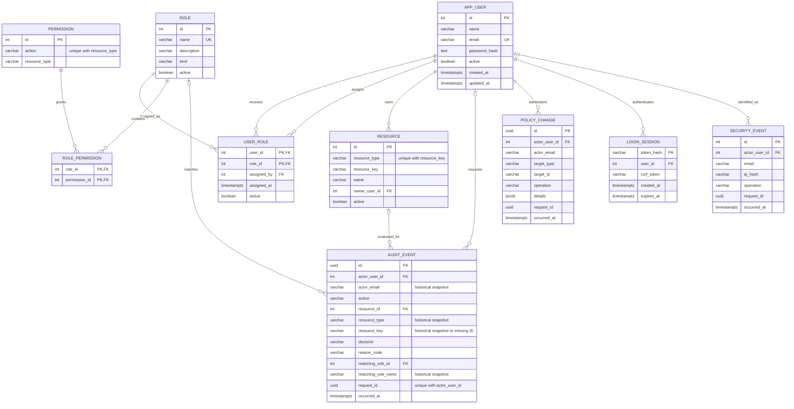

# Implemented entity relationship diagram

Printable submission copy: [complete ER diagram PDF](submission/ER_Diagram.pdf), split into three landscape views for readability. It covers all 10 application tables, 62 columns and 12 foreign keys. PK/FK markers, nullable references and a cardinality legend are included.

The original proposal's junction tables and resource registry are implemented.
The diagram below corrects the source diagram's simplified relationship between
USER_ROLE and ROLE_PERMISSION: both refer to ROLE independently. Session and
security-event tables support authentication rather than application policy.

All live references use PostgreSQL foreign keys with default NO ACTION deletion
behavior. The application deactivates records and revokes assignments; it never
deletes a user, role, resource, or audit record. A policy target is a historical
identifier rather than a polymorphic foreign key: JSON details capture removed
mappings after their deletion. All ten tables and both views are represented in
the data dictionary.
