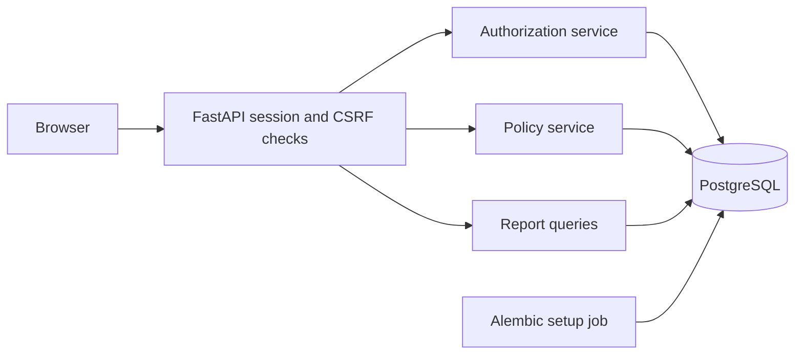

# Database Access Control and Audit System project report

Submission copies: [PDF report](submission/Project_Report.pdf) and
[editable Word report](submission/Project_Report.docx). The formatted report
includes the ER diagrams, data dictionary, screenshots and recorded test results.

## Introduction

Consider an analyst who needs to read a report but should not delete it. The
application must distinguish these operations and retain an explanation of the
outcome. Access Ledger handles this through a role-based policy stored in
PostgreSQL. The project brings together relational modelling, SQL queries,
constraints and transactions in one working application.

## Problem statement

A permission change can be difficult to trace when each screen applies its own
rules. Investigating an old request raises another problem: a user's roles today
may differ from the roles held when the request was made. The system therefore
records both access decisions and administrative changes. An auditor can examine
a recorded decision alongside the policy history.

## Objectives and scope

The project represents users, roles, permissions and resources in normalized
tables. A central service evaluates READ, CREATE, UPDATE and DELETE, denies access
without a matching active permission, and records each completed decision.
Administrative changes are committed together with their policy history.

The registry contains documents and reports, including the sample report R42.
An evaluation checks permission to perform an operation; it does not modify files
or intercept arbitrary SQL. Ownership is recorded but does not grant access on
its own. Administrators create accounts, and all demonstration records are fictional.

## User categories

| Category | Responsibilities |
| --- | --- |
| Administrator | Manage accounts, roles, permission mappings and resource status; assign and revoke roles; inspect policy and access history. |
| Ordinary user | Review active roles and effective permissions, browse resources, submit operations and inspect personal decisions. |
| Auditor | Search decisions, inspect event details, review policy/sign-in history and export bounded CSV reports; cannot write policy or submit evaluations. |

## Architecture

Requests start in the React interface and reach FastAPI on the same origin.
FastAPI checks the server session and, for a write, the CSRF token. It then calls
the service responsible for authorization, policy changes or reporting. The
service accesses PostgreSQL through SQLAlchemy. Decision and policy records are
written within these service transactions.

The stack includes Python, FastAPI, SQLAlchemy, psycopg, Pydantic, Alembic and
PostgreSQL 17. The frontend uses React, TypeScript, Vite, Tailwind, Radix dialogs
and Lucide icons. Docker Compose runs the database, setup job and web service.
TypeScript API types are generated from the FastAPI schemas.

The supplied SecureAuth project informed the layout and colour choices. Its
source and authentication were not copied. The reference review and licensing
boundary are described in [DESIGN_REFERENCE.md](DESIGN_REFERENCE.md).

## Database design and normalization

The schema has the eight proposal entities and two supporting tables for sessions
and sign-in activity. Together they contain 62 columns and 12 foreign keys. See
[the ER diagram](ERD.md) and [data dictionary](DATABASE_DESIGN.md). Alembic revision
0001 defines the schema; the standalone SQL is generated from it.

In first normal form, each role and permission occupies its own row. Users receive
roles through USER_ROLE instead of through a list inside the user record.

In second normal form, the full user/role pair identifies an assignment, and the
full role/permission pair identifies a mapping. Assignment details describe the
pair, while role descriptions and permission attributes remain in their own tables.

In third normal form, current entity attributes stay with their own keys. For
example, a role description is not repeated in each current assignment. PostgreSQL
also enforces candidate keys for email, role name, action/type and resource type/key.

Audit snapshots have a different purpose from current policy. Renaming a role
must not alter the explanation of an earlier allowed request. Each event therefore
retains the email, resource key, matching role and outcome recorded at that time.
Policy JSON records change details; it is not the source for new access decisions.

## Authentication and authorization

Passwords are hashed with Argon2id. After login, the browser receives an opaque
HttpOnly session cookie, and PostgreSQL stores the token digest, expiry and CSRF
token. The default session lifetime is eight hours. Login has signed CSRF
protection and failure throttling. An HTTPS deployment must enable Secure cookies.
Session tokens are not stored in localStorage or sessionStorage.

For each resource evaluation, the service:

1. Identifies the actor from the session and validates the operation, resource ID,
   request UUID and CSRF token.
2. Acquires the shared policy advisory lock and actor row lock, then checks for a
   replay of an existing request.
3. Checks the account and resource status.
4. Joins active assignments and roles to permissions for the requested action/type.
5. Selects the lowest matching role ID; otherwise, denies by default.
6. Inserts the decision, commits, and only then returns the result.

The reason codes distinguish a matching role, missing permission, inactive account,
inactive resource and missing resource. A failed audit write cannot return ALLOWED.
Invalid or unauthenticated requests are rejected before a completed evaluation.

## Transactions and history

Assigning a role changes what a user can do, so the assignment and its policy
record must succeed together. The policy service acquires an exclusive advisory
lock, rechecks administrator authority, validates the change, verifies that an
active administrator remains, and writes POLICY_CHANGE before committing.

If the history insert fails, the change rolls back. The tests install PostgreSQL
triggers that deliberately reject audit inserts to exercise this behaviour.
The lock also serializes competing administrative updates, preventing concurrent
changes from removing the final active administrator.

An actor/request UUID pair identifies one evaluation. Repeating its payload returns
the recorded result; changing the payload with the same ID produces a conflict.
A fresh request ID is needed to evaluate changed policy. This prevents a network
retry from creating another event or rewriting the original result.

The runtime database account can read and insert history but cannot update or
delete it. These restrictions protect normal application use. A privileged database
owner can still bypass them through direct SQL.

## SQL and reporting

The SQL directory contains CRUD examples, INNER/LEFT/multi-table joins, GROUP BY,
HAVING, aggregates, EXISTS, views, indexes, constraints, transactions and EXPLAIN.
[SQL_DEMONSTRATION.md](SQL_DEMONSTRATION.md) explains how to run them.

The investigations cover effective permissions, daily decision counts, changes
followed by access, current roles compared with historical matches, repeated
denials, changes by an administrator and history for a selected resource.

For example, the R42 history can show an allowed READ and a denied DELETE for the
same user. If a role is revoked later, a new request can be denied while the
earlier allowed decision remains unchanged.

The fresh seed contains 10 accounts, six roles, eight permissions, 16 resources,
180 decision events and 13 policy records. Its dates and inactive records support
filtering and denial demonstrations. The seed uses the authorization service to
create decisions under the application's actual rules.

## Verification results

These results are from 22 November 2026; editing the report did not rerun the suite.

| Check | Recorded result |
| --- | --- |
| Backend and PostgreSQL | 113 passed; one dependency deprecation warning; 56.84 seconds. |
| React component/API integration | 12 passed; 12.35 seconds. |
| Playwright browser workflows | 5 passed; 58.3 seconds. |
| Production build | TypeScript checks and Vite bundle succeeded. |
| Clean installation and live checks | Fresh-volume migration/seed, role workflows, CSV and logout passed. |

Tests cover the access rules, database constraints, rollback, retries, concurrent
administrator changes and report boundaries. Browser testing follows all three
categories through their main workflows and checks both themes and the mobile
layout. Missing select-label associations and mobile table-header overflow were
corrected before the final passing run.

The backend warning concerns Starlette's httpx compatibility client. It did not
cause a failure. The exact output and limits of the checks are retained in
[TEST_RESULTS.md](TEST_RESULTS.md).

## Interface evidence

The formatted report includes the administrator overview and a filtered auditor
table. More screenshots in `docs/screenshots/` show the member workspace, allowed
and denied decisions, policy details, both themes and mobile forms. Counts reflect
the fictional database state at capture time.

## Limitations and conclusion

MFA, SSO, self-service password recovery and automatic backup/retention jobs are
outside the current scope. External use requires HTTPS, Secure cookies, actual
account provisioning and monitoring. Resource ownership could support a later
policy extension, but it does not grant access in this version.

The R42 example shows the main result: the system distinguishes read and delete
permissions, records both outcomes, and changes future access after a revocation
without rewriting earlier decisions. Separate policy and history relations,
database constraints and transactions support that behaviour. The retained tests
cover these cases, including failures and competing administrative changes.

## Sources

The requirements come from the supplied proposal dated 27 September 2026. Schema,
SQL and test claims can be checked against the project files and retained output.
Technical references are listed in [SOURCES.md](SOURCES.md), including the official
SQLAlchemy documentation. Frontend reference use is documented separately above.
